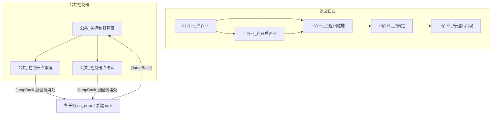

# 开启百业与控制器弹窗回收

日期：2026-10-13  
状态：已实现  
范围：`返回百业` 引导页 + 全界面任务共用的控制器弹窗关闭

## 背景

1. **返回百业**：从功能菜单点「百业」后，新号/未开户账号可能先进引导页，右下按钮文案为 **「开启百业」**（实测 OCR 框约 `[1090, 666, 108, 22]`，1280×720）。点过后才出现「返回驻地」。
2. **控制器弹窗**：模拟器切入控制器时游戏会挡操作。已有两种变体（文案不同）：
   - **A**：中间单按钮「确认」（文案含「控制器已连接」；买药已处理，见 `买药_关控制器弹窗`）。
   - **B**：左「取消」/ 右「确认」。B 暂无截图与精确文案；本轮约定 **点左「取消」**，文案待后补。

用户选择：弹窗关掉后用 **JumpBack 回失败节点**，不为所有任务补「确认当前界面」定位。

## 目标

| 项 | 行为 |
| --- | --- |
| 返回百业 | 点百业后若见「开启百业」则先点，再走「返回驻地 → 确定 → 等退出」 |
| 控制器弹窗 | 公共节点；各界面任务失败/关键识别路径可 JumpBack 关掉后再继续 |
| 非目标 | 全任务界面重定位；关「金丝宋元钱袋」浮层；改一条龙锚点拓扑 |

## 架构

## 1. 返回百业：开启百业

文件：`assets/resource/pipeline/return_baiye_task.json`，文档：`docs/zh_cn/tasks/返回百业.md`。

### 新节点

| 节点 | 识别 | 动作 | 说明 |
| --- | --- | --- | --- |
| `回百业_已见开启百业` | OCR「开启百业」，ROI 约 `[1000, 620, 270, 100]`，threshold ≥ 0.4 | DoNothing | 入口已在引导页时走这里，勿再点功能菜单「百业」 |
| `回百业_点开启百业` | 同上 | Click，max_hit 1 | 点完进「返回驻地」 |

### 接线

- 入口 `返回百业` 的 `next`：在 `回百业_已见返回驻地` 旁增加 `回百业_已见开启百业`（开启优先于再去开菜单点百业）。
- `回百业_点百业` 的 `next`：先 `回百业_点开启百业`，再 `回百业_点返回驻地`（无开启则直接返回驻地；timeout 仍覆盖过场）。
- `回百业_点开启百业` 的 `next`：`回百业_点返回驻地`；`on_error`：有返回驻地则继续，否则失败。

### 流程（更新后）

1. 主菜单 → 点「百业」（或已在百业子系统 / 引导页则跳过）。
2. （可选）点「开启百业」。
3. 点「返回驻地」→「确定」→ 等右上「退出」。

## 2. 公共控制器弹窗

文件：`assets/resource/pipeline/public_task.json`。

### 节点

| 节点 | 识别 | 动作 | next / 说明 |
| --- | --- | --- | --- |
| `公共_关控制器弹窗` | OCR「是否将控制设备」/「控制器已连接」等，ROI `[160, 180, 960, 360]` | DoNothing | `next`: 双按钮点取消 → OCR 取消 → OCR 确认 |
| `公共_控制器双按钮点取消` | OCR「是否将控制设备…」 | Click `target [140, 475]` | 按钮字 OCR 不稳；亮区约 `[78,456,126,38]` |
| `公共_控制器点取消` | OCR「取消」，ROI `[60, 440, 180, 70]` | Click | 备用 |
| `公共_控制器点确认` | OCR「确认」，ROI `[400, 360, 800, 200]` | Click | 单按钮变体 |

变体 B 文案：「控制器已连接，是否将控制设备切换为控制器？」；变体 A：「稍后可在设置…」单确认。

### 接入策略（JumpBack，不回入口）

1. **买药**：现有 `买药_关控制器弹窗` / `买药_点控制器确认` 及专用「先关控制器」分支改为指向或等价调用公共节点；行为扩展为取消优先。
2. **处理异常**：`处理异常` 的 `next` 前列入 `公共_关控制器弹窗`（或 JumpBack 包装节点），服务无限水井 / 蔬菜。
3. **其它界面任务**：各 `*_结束失败` 以及会因弹窗挡识别而失败的关键节点，在 `on_error` 或 `next` **先**挂 `[JumpBack]公共_关控制器弹窗`，点掉后回到原节点再试；仍失败再走原失败逻辑。
4. **不做**「关弹窗 → 一律回任务入口」。

界面任务清单（`interface.json`）：无限水井、修改为地基模式、无限集英、无限太极、自动买药、一条龙、自动炼药、自动天工、自动买钱、离开百业、返回百业、找温无双、存放原料、每日号令。**退出游戏**仍为空转：**本轮不挂**控制器回收。

## 3. 文档

| 文件 | 更新 |
| --- | --- |
| `docs/zh_cn/tasks/返回百业.md` | 步骤增加「开启百业」；流程图同步 |
| `docs/zh_cn/任务流程.md` | `处理异常` 说明中提及控制器弹窗公共节点 |
| `docs/zh_cn/tasks/自动买药.md`（若写了关控制器细节） | 指向公共节点、双变体 |

## 4. 验证

1. 第二模拟器停在「开启百业」：跑 `返回百业`，应点开启 → 返回驻地 → 确定 → 见退出。
2. 人为弹出变体 A：任意任务识别步应 JumpBack 点确认后继续。
3. 变体 B：有弹窗时点左取消（有截图后再收紧文案回归）。
4. 回归：已开户账号「返回百业」仍直接「返回驻地」，不误点其它右下按钮。

## 5. 安全原则

- 「开启百业」只点一次；与「返回驻地」ROI 分离，避免互点。
- 控制器：先取消后确认；识别依赖「控制器」相关文案或弹窗区取消，减少误点其它确认框。
- 认不到返回驻地 / 确定仍失败，不盲点固定坐标（保持现有返回百业原则）。

## 决策记录

| 决策 | 选择 |
| --- | --- |
| 关弹窗后继续方式 | JumpBack，不强制回入口 |
| 全任务界面定位 | 不做 |
| 控制器双变体 | A OCR 确认；B 认「是否将」后点取消坐标 (140,475)；取消优先 |
| 钱袋浮层 | 本轮不关 |
| 公共节点位置 | `public_task.json` |
