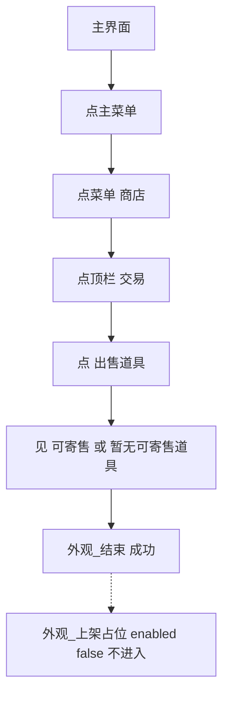

# 外观上架

本页说明界面任务「外观上架」。入口在 `assets/interface.json`，节点在 `assets/resource/pipeline/appear_list_task.json`，入口名 `外观上架`。无界面选项。不接入 [一条龙](一条龙.md)。

坐标与 ROI 均按控制器缩放到短边 720 后的 **1280×720** 图计算。流水线协议见 [任务流水线协议](https://github.com/MaaXYZ/MaaFramework/blob/main/docs/zh_cn/3.1-%E4%BB%BB%E5%8A%A1%E6%B5%81%E6%B0%B4%E7%BA%BF%E5%8D%8F%E8%AE%AE.md)。

> **实现状态**：V1 只导航到「出售道具」页并认出可寄售区。空可寄售算成功。真正上架（点条目、填价、确认）是 `enabled: false` 的占位，默认不执行。

## 目标

从主界面走到燕云商城的 **出售道具** 页：

**主菜单 → 商店 → 交易 → 出售道具**

与 [自动买钱](自动买钱.md) 不同：买钱走「菜单 → **不肝** → 商店」（不肝顶栏里的商店，左侧是战斗养成）。本任务 **主菜单展开后直接点「商店」**，进的是外观商城（顶栏：推荐 / 外观 / 精选 / 月卡 / 和鸣 / 福利 / **交易** / 充值），不点「不肝」，也不复用 `钱袋_点不肝` / `钱袋_点商店`。

到达后同时看见：

- 「出售道具」（子页签或页内标题，如「出售道具 0/6」）
- 「可寄售」或「暂无可寄售道具」

即任务 **SUCCEEDED**。可寄售为空（实测：出售槽 **0/6**、六格「空闲」、文案「暂无可寄售道具」，右侧标题仍是「可寄售」）也算成功，不失败。

成功后停在出售页，不点返回，不点可寄售条目。

## 与自动买钱的差别

| 项 | 外观上架 | 自动买钱 |
| --- | --- | --- |
| 商店入口 | 主菜单格子「商店」 | 主菜单「不肝」再点顶栏「商店」 |
| 到达页 | 交易 → 出售道具 | 不肝商店的战斗养成 / 赛季追赶 |
| 成功 | 认出可寄售区（含空） | 买完或库存/代币不足后回主界面 |
| 上架 / 购买 | 不点 | 会点购买 |

## 前置

- 人在 **主界面**（大世界），右上能点开主菜单。已停在商城、交易或出售页时，入口会从当前页接着走，不必退回主界面。
- 短边 720；中文 OCR 已就绪。
- 主菜单模板复用 `storage/主菜单.png`。失败时若在全屏界面里，返回箭头复用 `medicine/返回.png`。不新增模板。
- 成功路径没有新的自定义动作。失败收工复用已有 `打印失败节点`（`agent/debug_action.py`），因此和其它任务一样要带 Agent。Agent 没起来时这一步动作失败，任务仍然是失败。

## 步骤

起点：主界面。入口 `next` 按「已经走到哪」从后往前认，命中即从该步继续。

1. 已在出售页（「出售道具」且「可寄售」或「暂无可寄售道具」）：不点击，直接成功。
2. 已能看见子页签「出售道具」：点它，再做第 1 步的判定。
3. 已在商城（顶栏有「交易」）：点「交易」，再点「出售道具」。
4. 功能菜单已开（菜单区内同时有「商店」和「包裹 / 不肝 / 培养」之一）：不再点主菜单，直接点「商店」。
5. 否则点右上角 **主菜单**（模板，ROI `[1080, 0, 200, 90]`）。模板没有时盲点 `(1180, 45)`，只点一次。
6. OCR 点菜单里的 **商店**（ROI `[740, 150, 480, 280]`）。认不到则先盲点 `(950, 270)`，仍进不了商城再盲点 `(848, 316)`。两处都只点一次。两个盲点之后仍不见「交易」，改盲点顶栏 `(590, 42)`，不再回点商店。
7. OCR 点顶栏 **交易**（ROI `[360, 0, 480, 90]`，先整词「交易」，避免吃进「交易记录」）。点了仍不见「出售道具」，或 OCR 没点到，则盲点 `(590, 42)`（只点一次）。
8. OCR 点 **出售道具**（ROI `[150, 40, 750, 140]`）。认不到，或点了仍没有可寄售文案，则盲点 `(637, 97)`。
9. 判定成功（见下）。认不到则失败收场：右上有返回箭头就点 **一次**，然后 `外观_结束失败`。不循环点返回。

占位节点画成虚线：它在流水线文件里，**不在**成功 `next` 上。

## 成功条件

节点 `外观_认出售成功` 是 `And`，两个子识别都命中才进 `外观_结束`（`next` 为空，任务成功）：

| 子识别 | 期望 | ROI |
| --- | --- | --- |
| 出售页 | OCR「出售道具」 | `[150, 40, 750, 140]`（子页签和「出售道具 0/6」标题） |
| 可寄售区 | OCR「暂无可寄售道具」「暂无可寄售」或「可寄售」 | `[680, 40, 580, 640]`（右侧寄售栏） |

交易页只有子页签「出售道具」、还没有右侧「可寄售」时，`And` 不成立，会去点「出售道具」，不会提前成功。

「空闲」格数只作空仓外观，**不**单独当成功条件：有道具可寄售时格子不是「空闲」，只要右侧仍是「可寄售」即成功。

## 上架占位

`外观_上架占位`：

- `enabled: false`。MaaFramework 会跳过其它节点 `next` 里的它；本任务另外保证 **成功链根本不引用它**。
- `action` 是 `DoNothing`，没有点击坐标。
- 附注写明后续步骤：**点右侧可寄售条目 → 填价 → 确认上架**。有道具后再把本节点接在 `外观_认出售成功` 之后并打开 `enabled`。

本版不选道具、不填价、不点确认、不购买、不下架。

## 实机注记（1280×720）

燕云分身横屏。主菜单展开后，右侧功能格第二行左侧是「商店」（其上为「包裹」，其下为「不肝」）。点商店进入外观商城默认「推荐」。点「交易」后子页签为「外观推荐 / 珍品外观 / 武器外观 / 出售道具」。空仓出售页：标题「出售道具 0/6」，六格「空闲」，右侧「可寄售」下为「暂无可寄售道具」，右下有「交易记录」。

| 控件 | 识别 / 坐标 | 说明 |
| --- | --- | --- |
| 主菜单 | 模板 `storage/主菜单.png`，ROI `[1080, 0, 200, 90]`，阈值 0.75；兜底 `(1180, 45)` | 与存放相同图标 |
| 商店 | OCR「商店」，ROI `[740, 150, 480, 280]`；兜底 `(950, 270)` 再 `(848, 316)` | 菜单格子。两处坐标都盖在 ROI 内，优先 OCR |
| 交易 | OCR `^交易$`，ROI `[360, 0, 480, 90]`；兜底 `(590, 42)` | 商城顶栏 |
| 出售道具 | OCR「出售道具」，ROI `[150, 40, 750, 140]`；兜底 `(637, 97)` | 交易子页签 |
| 可寄售 / 空文案 | 见成功条件 | 空仓两者会同时出现 |
| 返回（仅失败） | `medicine/返回.png`，ROI `[1125, 0, 145, 68]` | 只在失败时点一次 |

每步盲点 `max_hit` 为 1。某步认不到会在短超时后走 `on_error`，不会来回死点。

## 安全原则

- 不点「不肝」，不调用买钱节点。
- 不点「可寄售」列表、不点「交易记录」、不点购买。
- 未知弹窗不盲点确定。失败最多点一次返回箭头，然后停住并失败。
- 成功必须是出售页文案，不能只因为看见顶栏「交易」或子页签「出售道具」就结束。

## 与流水线关系

| 项 | 说明 |
| --- | --- |
| 入口 | 界面任务「外观上架」；入口节点名 `外观上架` |
| 节点文件 | `assets/resource/pipeline/appear_list_task.json` |
| 选项 | 无 |
| 自定义动作 | 无新动作。失败时 `打印失败节点` |
| 与一条龙 / 买钱 | 不串联。商店入口单独写 |
| 结束后 | `外观_结束`，`next` 为空。不设锚点 |
| 发布 | `tools/publish_mfa.py` 整份复制 `assets/resource`，没有单独的 pipeline 名单要改 |

## 手动验证

仓库内的 `MFAAvalonia/` 被 gitignore，本机没有 MFA 时流水线无法在模拟器里点真机。接到 MFA 后：

1. `python tools/publish_mfa.py <MFAAvalonia目录>`（目录不存在会直接退出）。
2. **重启** MFAAvalonia.exe，让它重载 `interface.json`。资源选「官服」，控制器短边 720，连上燕云。
3. 人站在主界面（右上是主菜单，功能菜单未打开或已打开均可）。
4. 只勾选「外观上架」，开始。
5. 期望路径：主菜单 → **商店**（不要出现先点「不肝」）→ 顶栏 **交易** → **出售道具**。
6. 空仓应看到「可寄售」或「暂无可寄售道具」，任务成功，画面停在出售页。日志里不应出现对可寄售条目、价格框、确认钮的点击。
7. 若背包里已有可寄售道具：同样只停在出售页，任务成功，不进入填价。

## 已知未实现

- 点可寄售条目、填写价格、确认上架。
- 寄售下架、购买外观。
- 与一条龙串联；成功后不自动返回主界面。
