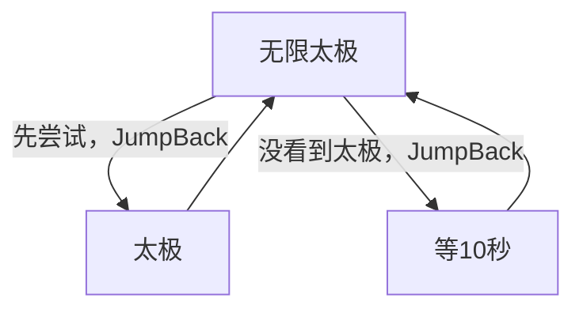

# 无限太极

本页说明界面任务「无限太极」。入口在 `assets/interface.json`，节点在 `assets/resource/pipeline/yysls_task.json`，入口名 `无限太极`。与 [无限集英](无限集英.md) 共用同一流水线文件，并共用其中的 `等10秒` 节点。

坐标与 ROI 均按控制器缩放到短边 720 后的 **1280×720** 图计算。点后等待需要 Python Agent。

## 目标

反复寻找并点击屏幕上的「太极」。本轮找不到就先空等 10 秒，再继续找。任务不会自行结束，需外部停止。

## 界面选项 `太极点后等待`

挂在任务「无限太极」的 `option` 上，类型 **`input`**。齿轮里填的是点后等待的**秒**（正整数）。`pipeline_override` 只把这个秒数放进入口节点 `无限太极` 的 `custom_action_param.seconds`。Agent 动作 `太极_应用点后等待`（`agent/yysls_action.py`）乘 1000，再 `override_pipeline` 写到「太极」的 `post_delay`（毫秒）。

| 项 | 说明 |
| --- | --- |
| 选项名 | `太极点后等待` |
| 类型 | `input` |
| 输入名 | `太极点后等待秒` |
| 标签 | 点后等待（秒） / 等待（秒） |
| `pipeline_type` | `int` |
| `verify` | `^[1-9][0-9]*$`（正整数；空、0、小数不能开始） |
| `default` | `20` |
| 写入 | `太极` 的 `post_delay` = 秒 × 1000 |
| 非法参数 | 界面拦下空输入；Agent 若仍收到空值或非正整数，退回 20 秒（20000 毫秒） |

流水线 JSON 里「太极」仍写着默认 `post_delay` **20000**。选项不会把秒直接写进 `post_delay`。找不到目标时的 `等10秒` 仍是 10 秒，不受这个齿轮影响。

## 步骤

1. 入口 `无限太极`：`DirectHit`，自定义动作 `太极_应用点后等待`。先按上面的规则写好「太极」的 `post_delay`。`next` 仍为 `[JumpBack]太极`、`[JumpBack]等10秒`——每一轮**先**尝试「太极」，未命中再走「等10秒」。两条后继都带 JumpBack，走完都会回到本入口并再写一次等待。点击 ROI、阈值和这层循环不变。
2. **太极**：OCR 期望「太极」，阈值 `0.8`，ROI `[880, 450, 280, 160]`，点击后 `post_delay` 为齿轮秒数 × 1000，默认 **20000**（20 秒）。`next` 为空，随后跳回入口再认。
3. **等10秒**：与集英相同，本文件内 `DoNothing`，`post_delay` **10000**。本轮没看到「太极」时进入，等完再回入口。

因此运行中会一直交替做「点太极（成功则按齿轮秒数等待，默认 20 秒）」和「等 10 秒再找」，直到外部停止。

## 节点一览

| 节点 | 识别 / 动作 | ROI | 点击后等待 |
| --- | --- | --- | --- |
| `无限太极` | `DirectHit` + `太极_应用点后等待`；后继 `[JumpBack]太极`、`[JumpBack]等10秒`；`on_error` → 自己 | — | 把秒写成「太极」的 `post_delay` |
| `太极` | OCR「太极」，阈值 0.8，Click | `[880, 450, 280, 160]` | 默认 20 秒，齿轮可改 |
| `等10秒` | `DoNothing`（与集英共用） | — | 10 秒 |

阈值写死为 `0.8`。ROI 为 `[880, 450, 280, 160]`。

## 安全原则

- 只点 OCR「太极」命中项；认不到只走 `等10秒`，不盲点。
- 点中后按齿轮里的秒数等待再进入下一轮。默认 20 秒。等待为 0 时不能开始，Agent 收到非法秒数时也退回 20 秒，避免连点。
- `等10秒` 无识别、立刻命中，正常画面下后继列表不会因「等不到节点」超时；入口 `on_error` 指向自己，主要兜动作失败一类情况。
- 不改写集英侧节点；两任务只是共用 `yysls_task.json` 与 `等10秒`。

## 与流水线关系

| 项 | 说明 |
| --- | --- |
| 入口 | 界面任务「无限太极」；入口节点名 `无限太极` |
| 节点文件 | `assets/resource/pipeline/yysls_task.json`（与 [无限集英](无限集英.md) 同文件） |
| 选项 | `太极点后等待`：点后等待秒数，默认 20 |
| Agent | 需要。`太极_应用点后等待` 把秒 × 1000 写入 `post_delay` |
| 结束条件 | 无；外部停止前一直循环 |