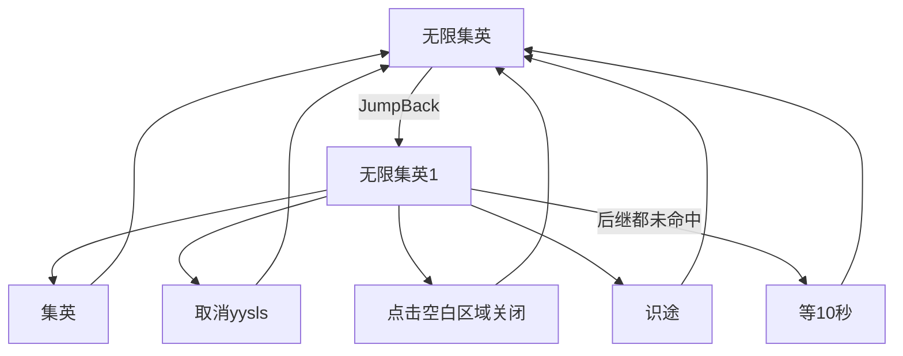

# 无限集英

本页说明界面任务「无限集英」。入口在 `assets/interface.json`，节点在 `assets/resource/pipeline/yysls_task.json`，入口名 `无限集英`。文件名与内部节点 `取消yysls` 仍带 `yysls` 字样，界面展示名是「无限集英」。

坐标与 ROI 均按控制器缩放到短边 720 后的 **1280×720** 图计算。点后等待需要 Python Agent。

## 目标

在能点到「集英」的画面里反复点击，形成无限循环。顺带处理同屏可能出现的「取消」和「点击空白区域关闭」。都找不到时先点左下角「识途」、等 3 秒再找；「识途」也没有则空等 10 秒。

任务不会自行结束，需外部停止。

## 界面选项 `集英点后等待`

挂在任务「无限集英」的 `option` 上，类型 **`input`**。齿轮里填的是点后等待的**秒**（正整数）。`pipeline_override` 只把这个秒数放进入口节点 `无限集英` 的 `custom_action_param.seconds`。Agent 动作 `集英_应用点后等待`（`agent/yysls_action.py`）乘 1000，再 `override_pipeline` 写到「集英」和「集英_OCR」的 `post_delay`（毫秒）。

| 项 | 说明 |
| --- | --- |
| 选项名 | `集英点后等待` |
| 类型 | `input` |
| 输入名 | `集英点后等待秒` |
| 标签 | 点后等待（秒） / 等待（秒） |
| `pipeline_type` | `int` |
| `verify` | `^[1-9][0-9]*$`（正整数；空、0、小数不能开始） |
| `default` | `11` |
| 写入 | `集英`、`集英_OCR` 的 `post_delay` = 秒 × 1000 |
| 非法参数 | 界面拦下空输入；Agent 若仍收到空值或非正整数，退回 11 秒（11000 毫秒） |

流水线 JSON 里这两个节点仍写着默认 `post_delay` **11000**。选项不会把秒直接写进 `post_delay`。

## 步骤

1. 入口 `无限集英`：`DirectHit`，自定义动作 `集英_应用点后等待`。先按上面的规则写好点击节点的 `post_delay`，再走 `next` 里唯一的 `[JumpBack]无限集英1`。内层任意后继走完（含等待）都会跳回本入口，再写一次等待并进内层。点击 ROI、阈值和这层循环不变。
2. 内层 `无限集英1`：`DoNothing`。按顺序尝试模板「集英」、OCR「集英_OCR / 取消 / 关闭 / 识途」；都未命中则 `on_error` → `等10秒`。
3. **集英**：先 **TemplateMatch** `yysls/jiying_btn.png`（灵赋·集英图标+文字），ROI 右下大区 `[800, 360, 0, 0]`，阈值 `0.7`。认不到再走 **集英_OCR**（户外白字在 MFA 里常 `all:[]`，与天工菜单 OCR 不是同一场景）。点击后 `post_delay` 为齿轮秒数 × 1000，默认 **11000**（11 秒）。
4. **取消yysls**：OCR 期望「取消」，阈值 `0.8`，ROI `[0, 0, 720, 0]`（左侧宽 720、通高），点击后 `post_delay` **200**。
5. **点击空白区域关闭**：OCR 期望「点击空白区域关闭」，阈值 `0.8`，ROI `[0, 360, 0, 0]`（下半屏），点击后 `post_delay` **200**。
6. **识途**：OCR 期望「识途」，阈值 `0.7`，ROI `[0, 560, 320, 160]`（左下角）。点击后 `post_delay` **3000**（3 秒），再回外层继续找集英。第一台实测文字框约 `[186, 669, 30, 15]`、分约 `0.999`。
7. **等10秒**：本文件内定义的节点（不是 `public_task.json` 里的 `等一分钟`）。`DoNothing`，`post_delay` **10000**，`next` 为空，再回外层循环。

## 节点一览

| 节点 | 识别 / 动作 | ROI | 点击后等待 |
| --- | --- | --- | --- |
| `无限集英` | `DirectHit` + `集英_应用点后等待`；`[JumpBack]无限集英1` | — | 把秒写成下面两节点的 `post_delay` |
| `无限集英1` | `DoNothing`；后继含集英/取消/关闭/识途，失败 → `等10秒` | — | — |
| `集英` | TemplateMatch `yysls/jiying_btn.png`，阈值 0.7，Click | `[800, 360, 0, 0]` | 默认 11 秒，齿轮可改 |
| `集英_OCR` | OCR「灵赋·集英」等（含误读），阈值 0.7，Click | `[800, 360, 0, 0]` | 默认 11 秒，齿轮可改 |
| `取消yysls` | OCR「取消」，阈值 0.8，Click | `[0, 0, 720, 0]` | 200 ms |
| `点击空白区域关闭` | OCR「点击空白区域关闭」，阈值 0.8，Click | `[0, 360, 0, 0]` | 200 ms |
| `识途` | OCR「识途」，阈值 0.7，Click | `[0, 560, 320, 160]` | 3 秒 |
| `等10秒` | `DoNothing` | — | 10 秒 |

「集英 / 识途」阈值为 `0.7`；「取消 / 关闭」仍为 `0.8`。

## 安全原则

- 只点模板「集英」、OCR「集英_OCR / 取消 / 关闭 / 识途」命中项；都认不到才等 10 秒，不盲点固定坐标。
- 「取消」只扫左半屏（宽 720），避免误点右侧「集英」一带。
- 「识途」只扫左下 ROI，点完固定等 3 秒再找集英。
- 点「集英」后按齿轮里的秒数等待再进入下一轮。默认 11 秒。等待为 0 时不能开始，Agent 收到非法秒数时也退回 11 秒，避免连点。
- 入口 `on_error` 指向自己；正常画面下内层会立刻命中，该字段不负责「按钮都没看到」（那是内层 `on_error` → `等10秒`）。

## 与流水线关系

| 项 | 说明 |
| --- | --- |
| 入口 | 界面任务「无限集英」；入口节点名 `无限集英` |
| 节点文件 | `assets/resource/pipeline/yysls_task.json`（与 [无限太极](无限太极.md) 同文件） |
| 选项 | `集英点后等待`：点后等待秒数，默认 11 |
| Agent | 需要。`集英_应用点后等待` 把秒 × 1000 写入 `post_delay` |
| 结束条件 | 无；外部停止前一直循环 |
