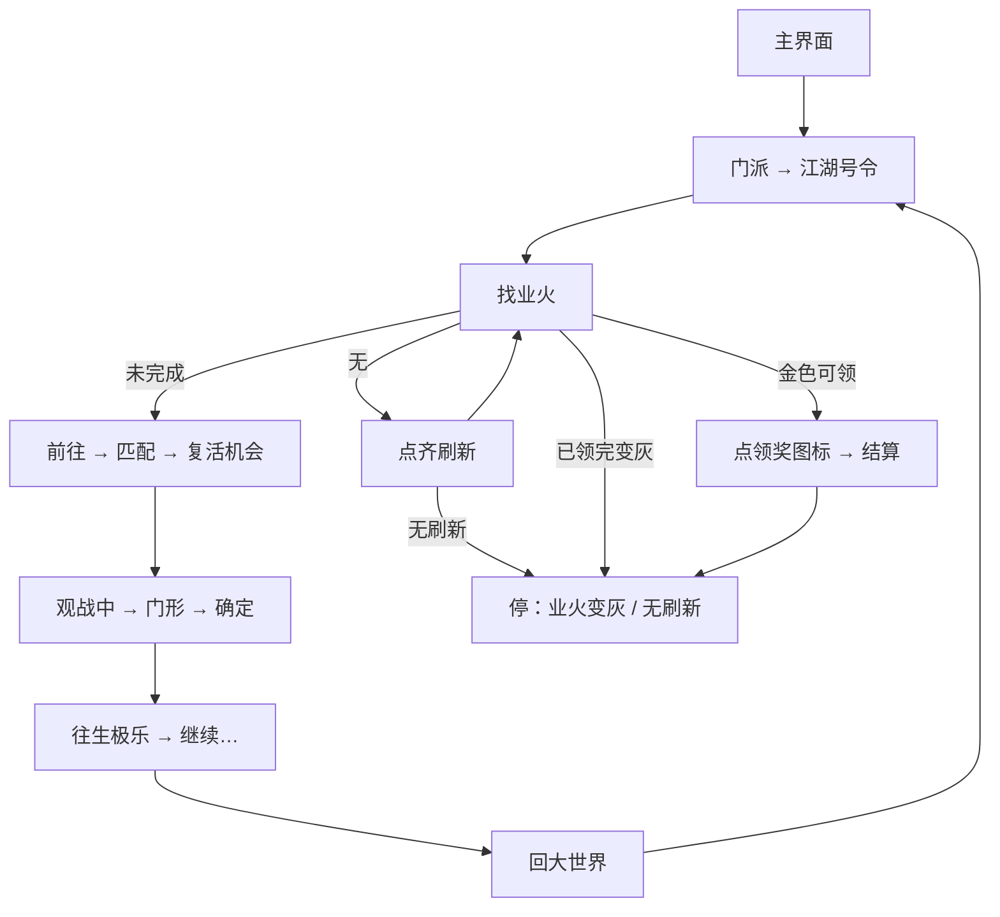

# 每日号令

本页说明界面任务「每日号令」。入口在 `assets/interface.json`，节点在 `assets/resource/pipeline/daily_order_task.json`，入口名 `每日号令`。

坐标与 ROI 均按控制器缩放到短边 720 后的 **1280×720** 图计算。不依赖 Python Agent。不接入 [一条龙](一条龙.md)。

## 目标

入口会先 **定位当前步骤** 再接着跑（不必总从主界面开始）：观战中 / 继续 / 往生极乐 / 战斗中 / 匹配中 / 开始匹配 / 前往 / 业火 / 号令页 / 功能菜单 / 主菜单。

完整一圈仍是：菜单 → 门派 → 江湖号令 → 刷业火 → 前往匹配 → 战斗退出 → 回主界面再开号令；业火金色高亮时点标题下两个领奖图标（右枚带数量）→ 关结算 → 业火变灰（见「参与…觉障林」）结束。无业火且无刷新作兜底。

## 前置

主界面能点右上角主菜单。模板用已有的 `storage/主菜单.png`，ROI `[1080, 0, 200, 90]`。战斗内门形模板 `daily_order/exit_door.png`（无「退出」文字，位置与离开百业不同）。

## 步骤

1. 功能菜单已开并能 OCR「门派」：不再点主菜单；否则点主菜单。
2. OCR 点「门派」→「江湖号令」→ 等左上「号」/「号令」。
3. 轮询「业火焚身」：已领完变灰 → 结束；金色高亮 → 点两个领奖图标并关结算；未完成则点进详情；没有业火则认刷新。
4. 点「业火焚身」→「前往」→「开始匹配」或已见「匹配中」。
5. 等「复活机会」→ 观战中则门形退出 / 或直接「继续」→ 往生极乐 → 继续；大厅先退匹配再返回主界面。
6. 再从菜单进号令，领完业火为止。已在战斗/匹配中可用入口 `每日号令_战斗循环`。

## 节点一览

| 节点 | 识别 / 动作 | 说明 |
| --- | --- | --- |
| `每日号令` | 入口 | 先定位当前步骤再接着循环 |
| `号令_业火已领完` | And：业火 +「参与/觉障」 | 领奖后变灰 → 结束 |
| `号令_业火可领奖` / `点业火领奖` | 金色高亮 / 图标模板 | 点两枚领奖图标（右枚带数量） |
| `号令_领奖结算` | OCR 确定/继续/领取 | 关掉结算再确认变灰 |
| `号令_见业火焚身` | OCR 点击 | 未完成业火进详情 |
| `号令_点前往` / `号令_点开始匹配` | OCR | 后者失败可认「匹配中」 |
| `号令_已在匹配中` | OCR「匹配中」 | 跳过再点开始 |
| `号令_等复活机会` / `号令_匹配续等` | OCR 左上 / 大厅 | 进战斗；单段约1小时，仍在匹配则续等 |
| `号令_战斗后分支` | DirectHit | 观战中或直接继续 |
| `号令_等观战中` | OCR 右下 | → 点门形 |
| `号令_点门形` | 模板 `exit_door.png` | ROI 右上 |
| `号令_点退出确定` | 级联 | 观战中 →「确定」；进行中 →「是」 |
| `号令_退出点确定` / `号令_退出点是` | OCR / 模板 | 点完只进往生极乐 |
| `号令_点往生极乐` | OCR 点击 | `post_delay` 3200ms 后再认继续 |
| `号令_点继续` / `号令_继续后分支` | OCR / 分支 | 多页继续可连点（max_hit 8）；再判观战中/继续/大厅/主界面 |
| `号令_在匹配大厅` | OCR「开始匹配」等 | 不点击，转点返回 |
| `号令_大厅点返回` / `…模板` | OCR/模板返回 | 直到主菜单 |
| `号令_回大世界` | 模板主菜单 | 再开号令循环 |
| `号令_检查刷新` / `点刷新0`…`5` | 刷新模板 | 无刷新 → 结束 |
| `每日号令_结束` | | 暂作刷完 |

## 安全原则

- 没业火时先认刷新；没有刷新不要盲点。
- 战斗门形只用模板，不复用离开百业的「退出」OCR。
- 观战中出现后再点门形，避免战斗中途误退。

## 与流水线关系

| 项 | 说明 |
| --- | --- |
| 入口 | 「每日号令」 |
| 节点文件 | `daily_order_task.json` |
| 模板 | `refresh.png`、`refresh_dark.png`、`exit_door.png` |
| 结束 | 业火领奖变灰；或无业火且无刷新 |
| 模板 | `claim_icon.png`、`claim_icon_num.png` | 领奖图标 |
