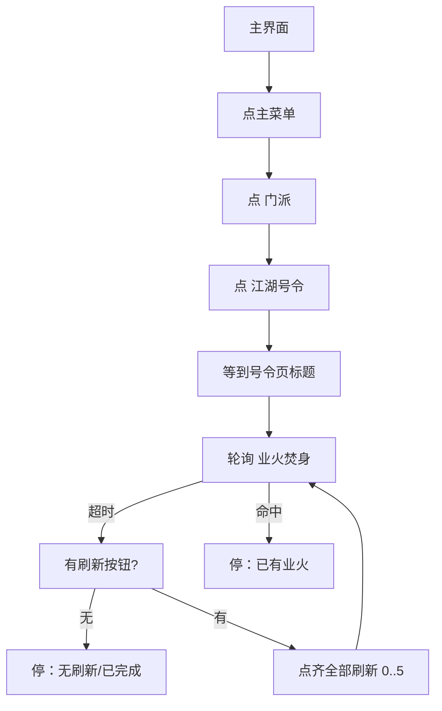

# 每日号令

本页说明界面任务「每日号令」。入口在 `assets/interface.json`，节点在 `assets/resource/pipeline/daily_order_task.json`，入口名 `每日号令`。

坐标与 ROI 均按控制器缩放到短边 720 后的 **1280×720** 图计算。不依赖 Python Agent。不接入 [一条龙](一条龙.md)。

## 目标

人在主界面。打开 **菜单 → 门派 → 江湖号令**。号令页打开之后，OCR 查找 **业火焚身**。

- 页面上已经有：停在号令页。不点「业火焚身」，也不点刷新。
- 没有业火：先认刷新按钮。
  - **没有刷新**：视为号令已完成/不可再刷，正常结束。
  - **有刷新**：按 Vertical 顺序点齐同屏全部刷新（最多 6 枚），再回查找业火；仍没有则再检查刷新，如此循环。

找到后不接取。

## 前置

主界面能点右上角主菜单。模板用已有的 `storage/主菜单.png`，ROI `[1080, 0, 200, 90]`，与 [返回百业](返回百业.md)、[自动买钱](自动买钱.md) 相同。

人已经停在门派页或号令页时，本文不另写往回点的路径。

## 步骤

1. 功能菜单已经开着并能 OCR 到「门派」：不再点主菜单。
2. 否则点右上角主菜单，只点一次。
3. OCR 点「门派」，只点一次。
4. OCR 点「江湖号令」，只点一次。
5. 等到左上角「号」/「号令」，进入查找循环。
6. 轮询 OCR「业火焚身」；命中则停。
7. 没有业火：模板认刷新（浅色 `refresh.png` + 深色 `refresh_dark.png`）。
8. 认不到刷新 → `每日号令_结束`。
9. 认到刷新 → 依次点 index `0`…`5`；某一档没有则跳过点下一档；全部试完再回查找。

## 节点一览

| 节点 | 识别 / 动作 | 说明 |
| --- | --- | --- |
| `每日号令` | `DoNothing` | 入口 |
| `号令_已开功能菜单` | OCR「门派」，不点击 | 菜单已开则跳过主菜单 |
| `号令_点主菜单` | 模板 `storage/主菜单.png`，`max_hit` 1 | ROI `[1080, 0, 200, 90]` |
| `号令_点门派` | OCR「门派」，`max_hit` 1 | |
| `号令_点江湖号令` | OCR「江湖号令」，`max_hit` 1 | |
| `号令_等号令页` | OCR「号令」/`^号$` | 打开成功后进查找 |
| `号令_查找业火` | `DoNothing` | `next` 等业火；超时 → 检查刷新 |
| `号令_见业火焚身` | OCR「业火焚身」，不点击 | 命中结束 |
| `号令_检查刷新` | 模板刷新，不点击 | 没有 → `每日号令_结束`；有 → 点刷新0 |
| `号令_点刷新0`…`5` | 模板 Vertical/`index` n，点击 | 该档没有 → 跳过点下一档；`5` 之后回查找 |
| `每日号令_结束` | `DoNothing` | 无业火且无刷新，正常结束 |
| `每日号令_结束失败` | `DoNothing` | 导航失败 |

## 安全原则

- 主菜单、门派、江湖号令都只点认到的那一次。
- 「业火焚身」只识别，不点击接取。
- 先确认号令页标题，再查找。
- 没业火时必须先认刷新；没有刷新不要盲点。
- 有刷新则一轮点齐（按 index），不固定只点第一枚。

## 与流水线关系

| 项 | 说明 |
| --- | --- |
| 入口 | 界面任务「每日号令」 |
| 节点文件 | `assets/resource/pipeline/daily_order_task.json` |
| 模板 | `assets/resource/image/daily_order/refresh.png`、`refresh_dark.png` |
| Agent | 不需要 |
| 一条龙 | 不调用 |
| 结束 | 见到业火；或无业火且无刷新（已完成） |
